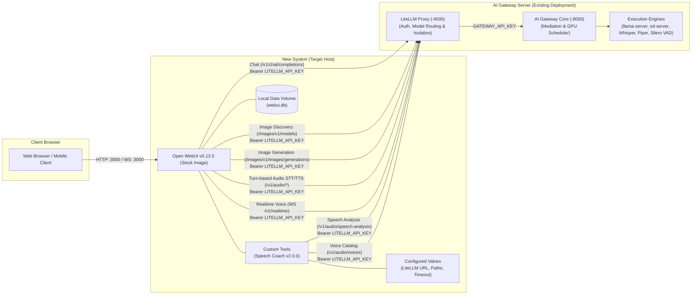

# Open WebUI Portable Deployment Package & Setup Guide

This repository contains the complete, reusable, production-tested deployment package for our enhanced **Open WebUI v0.13.5** implementation. It enables deploying Open WebUI onto any physical or virtual system—on-premise, cloud VM, or developer workstation—connecting back to the **existing LiteLLM Proxy** on our central AI Gateway server.

---

## 1. Architectural Topology



### Core Architecture Principles

1. **Zero Local Inference Infrastructure:** The target machine requires only Docker, Docker Compose, and Python 3. No local GPUs, Vulkan/ROCm drivers, or inference engines (`llama.cpp`, `sd.cpp`, Faster-Whisper, Piper) are needed.
2. **Complete Credential & Network Isolation:** Open WebUI possesses **zero knowledge of Gateway credentials** (`GATEWAY_API_KEY`) and no direct network route to internal Gateway services (`gateway-api:8000`). All interactions are mediated through LiteLLM using a standard API key (`LITELLM_API_KEY`).
3. **Pinned Stock Base + Verified v0.13.5 Compatibility Patches:** Open WebUI runs from `ghcr.io/open-webui/open-webui:v0.13.5` with SHA-256-verified patches (`patches/v0.13.5/B1EqPYAs.js` for native 44.1/48 kHz AudioWorklet resampling, mobile touch/pointer audio unlock, Standard Voice `ask_user` card overlay, and Live Mode Speech Coach UI, `ask_user.py` and `builtin.py` allowing 0 or more options with text input, plus `middleware.py`, `headers.py`, `audio_init.py`, and `audio_realtime.py` for voice-mode low-latency routing, request correlation IDs, `X-Voice-Mode`/`X-STT-Profile` forwarding, single-pass OpenAI STT language handling, and Speech Coach `/audio/speech-analysis` forwarding) mounted read-only and applied automatically at startup (`openwebui_v0135_entrypoint.sh`). Unexpected upstream file hashes are rejected automatically without overwriting. All legacy v0.11.1 monkey-patches remain retired.
4. **Strict Model Segregation:** LiteLLM isolates image models under `/images/v1/models`. The text chat model selector is never polluted with diffusion checkpoints.
5. **Configurable Endpoint Mobility:** Every endpoint, key, path, port, and timeout is configurable via `.env` or `configure.py` without modifying Python source code.

---

## 2. Quick Setup (3 Steps)

### Step 1: Configure Your Target LiteLLM Connection
```bash
python3 configure.py \
    --litellm-url "https://litellm.example.com" \
    --api-key "sk-your-litellm-master-key" \
    --port 3000
```

### Step 2: Run the Automated Installer
```bash
./install.sh
```

### Step 3: Verify All 14 Integration Targets
```bash
python3 validate.py
```

---

## 3. Package File Structure

```
open-webui-portable/
├── README.md                      # Package overview and setup guide (this file)
├── INSTALL.md                     # Step-by-step deployment guide
├── CONFIGURATION.md               # Detailed configuration guide for all parameters
├── UPGRADE.md                     # Version upgrade runbook and rollback procedure
├── TROUBLESHOOTING.md             # Common deployment, connectivity, and auth resolutions
├── .gitignore                     # Git ignore rules (prevents committing secrets or databases)
├── env.example                    # Template environment file with variable definitions
├── docker-compose.yml.template    # Docker Compose template for Open WebUI v0.13.4
├── install.sh                     # Automated, idempotent installer script
├── configure.py                   # CLI and interactive configuration manager
├── validate.py                    # 15-target automated integration validation suite
├── patches/
│   └── v0.13.4/
│       ├── BnHPywC-.js            # Patched v0.13.4 realtime AudioWorklet bundle (mobile resampler + unlock)
│       ├── BnHPywC-.js.orig       # Verified original v0.13.4 upstream bundle backup
│       ├── openwebui_realtime_entrypoint.sh  # Idempotent startup patcher with SHA-256 verification
│       └── patch_openwebui_v0134_realtime.py # CLI patch/status/rollback utility
├── tools/
│   ├── speech_coach_tool.py       # Speech Coach v2.0.0 custom tool source with Valves
│   ├── register_tool.py           # Tool registration script (DB & API modes)
│   └── valves.example.json        # Reference Valves configuration JSON
└── optional-patches/
    ├── README.md                  # Evolution report: retired v0.11.1 patches vs v0.13.4 mobile patch
    ├── legacy_v0.11.1/            # Archived v0.11.1 patches (for reference/audit only)
    │   ├── 34.DRvNJD_W.js
    │   ├── D5GoHi-U.js
    │   ├── audio.py
    │   ├── fwivdHaq.js
    │   └── images.py
    └── realtime_voice/
        └── patch_openwebui_realtime.py  # Standalone legacy v0.11.1 CallOverlay patcher
```

---

## 4. First-Time Administrator Setup

After running `./install.sh`, perform the following one-time setup steps in your browser:

1. **Bootstrap Admin Account:**
   - Open `http://<your-host-ip>:3000` in your web browser.
   - Click **Sign Up**. The first registered user automatically becomes the system **Administrator** (`role: admin`).
2. **Verify Speech Coach Tool:**
   - In Open WebUI, navigate to **Workspace** -> **Tools**.
   - Verify **Speech Coach & Pronunciation Assessment** is listed and active (`is_active: true`).
   - Click the gear icon to inspect or adjust Valves (`litellm_base_url`, `timeout`).
3. **Use Speech Coach in Chat:**
   - In any chat window, click the **+ (Tools)** button and select **Speech Coach & Pronunciation Assessment**.
   - Ask: *"List available languages and voices for speaking practice"* or *"Give me a pronunciation practice sentence in Spanish"*.
4. **Use Realtime Voice Calls:**
   - Click your profile avatar (bottom-left) -> **Settings** -> **Audio**.
   - Under **Call Settings**, ensure a voice is selected (e.g. `en_US-lessac-medium` or `alloy`).
   - In any chat, click the **Call (Headphones)** button to initiate a full-duplex realtime voice conversation.

---

## 5. Documentation Map

* [INSTALL.md](INSTALL.md) — Complete installation guide for fresh deployments.
* [CONFIGURATION.md](CONFIGURATION.md) — Comprehensive guide to all configurable variables and remote HTTPS setups.
* [UPGRADE.md](UPGRADE.md) — Runbook for upgrading Open WebUI container versions while preserving user data and custom tools.
* [TROUBLESHOOTING.md](TROUBLESHOOTING.md) — Diagnostic checklists and solutions for network, authentication, and database issues.
* [optional-patches/README.md](optional-patches/README.md) — Evolution analysis and archive of retired v0.11.1 patches.
